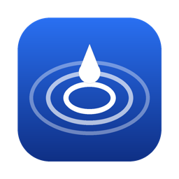
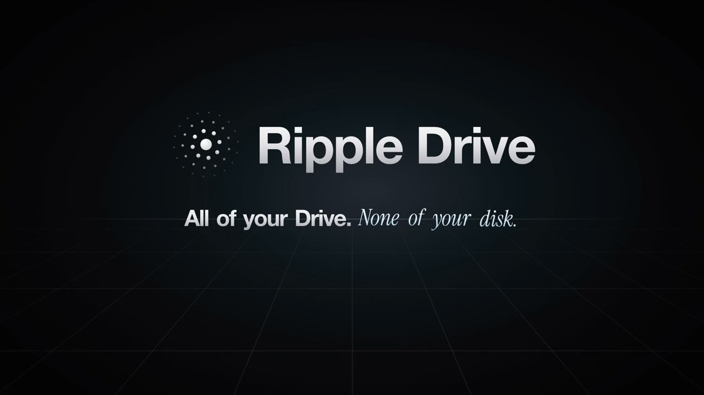
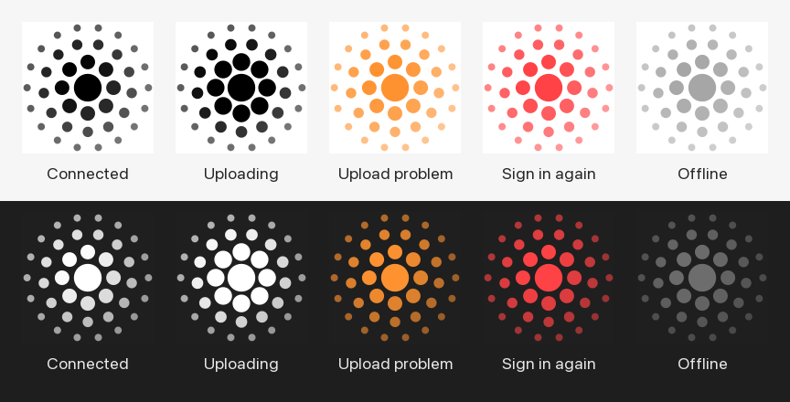

<p align="center">
  
</p>

<h1 align="center">Ripple Drive</h1>

<p align="center">
  <b>All of your Google Drive. None of your disk.</b><br>
  Your whole Google Drive as a disk on your Mac. Files open in seconds and stream as you use them,
  so a 50 GB video doesn't need 50 GB free.
</p>

<p align="center">
  <a href="docs/media/launch-film.mp4"></a><br>
  <sub>▶ Watch the 45-second film</sub>
</p>

---

## What it does

- **Your whole Drive in Finder.** `~/RippleDrive` holds **My Drive** and **Shared with me**, appears in the Finder sidebar, and works with any app that opens files from a disk: video editors, QuickTime, Photoshop.
- **Almost no space on your Mac.** Only the parts of a file an app actually reads are downloaded. The cache is capped at 2 GB, cleared 15 minutes after you stop using a file, and always leaves 3 GB of your disk free.
- **Uploads that survive anything.** Big files go up in 32 MB pieces, read straight from the original (no copy first). Sleep, Wi-Fi drops, crashes and restarts are fine: the upload carries on from Google's last confirmed byte. Every upload is checked against Drive's MD5, and **Move** sends the original to the Trash only after that check passes.
- **A menu-bar app.** It shows status and upload progress (pause or cancel each one), has a drop tile for files dragged from Finder, **⌃⌥F** search by file name across your whole Drive, one-click share links, and **Upload / Move / Copy Link** in Finder's right-click menu.
- **Stays connected.** It starts at login, and a watchdog remounts the drive within a minute if it drops.
- **Private by design.** It uses your own Google client ID and talks only to Google. No server, no account, no analytics.

<p align="center"></p>

## Requirements

| | |
|---|---|
| Mac | Apple Silicon (M1 or later) |
| macOS | 26 or later (uses Apple's FSKit) |
| Tools | Apple's Command Line Tools (the installer offers them), [Homebrew](https://brew.sh) for fuse-t |
| Google | Your own free Google Cloud client ID: about 10 minutes, see **[docs/google-setup.md](docs/google-setup.md)** |

## Install (about 15 minutes)

Prefer a click-by-click walkthrough? **[Open the step-by-step setup guide](https://kundankishore8929-gif.github.io/ripple-drive/setup.html)** (copy buttons for every command, progress checklist).

1. **Make your Google client ID** with **[docs/google-setup.md](docs/google-setup.md)**. Keep the client ID and secret handy.
2. **Download this repo:** the green **Code** button › **Download ZIP**, then unzip it. Or use `git clone`.
3. **Run the installer** in Terminal from the unzipped folder:
   ```bash
   cd ~/Downloads/ripple-drive-main      # the folder you unzipped
   zsh install.sh
   ```
   It installs fuse-t (through Homebrew) and the official rclone release (checksum-verified), builds the menu-bar app on your Mac, and asks for your client ID and secret. Then Google's sign-in page opens.
4. **Turn on fuse-t once:** System Settings › General › Login Items & Extensions › Extensions › **By Category** › File System Extensions › **fuse-t** on.
5. **Done.** **Ripple Drive** appears in the Finder sidebar and the Ripple icon appears in the menu bar.

Everything installs into your home folder (`~/.local/bin`, `~/Applications`, `~/Library/LaunchAgents`). Run `zsh install.sh` again any time to update.

## Daily use

| To | Do this |
|---|---|
| Open or play a file | Open it from **Ripple Drive** in Finder, like any disk |
| Upload big files | Right-click › **Upload to Ripple Drive** (or drag onto the tile under the menu-bar icon) and pick the folder |
| Upload and free the space | Right-click › **Move to Ripple Drive**: the original goes to the Trash once Drive's checksum matches |
| Find a file | **⌃⌥F**, type a name. ⏎ opens, ⌘⏎ shows in Finder, ⌘⇧C copies a share link |
| Share a link | Right-click › **Copy Ripple Drive Link** |
| Fix a stuck drive | Menu-bar icon › **Reconnect Drive** (about 10 seconds) |

From Terminal (add `~/.local/bin` to your `PATH`):

```bash
ripple-drive-upload ~/Movies/shoot-day-2 --to "My Drive/Raw archive"
```

Add `--move` to that command to send the originals to the Trash once Drive's checksum matches. Use `ripple-drive-upload --status` to list unfinished uploads, `ripple-drive-find search invoice march` to search, and `ripple-drive-signin` to sign in again.

> **Tip:** for files bigger than a few GB, use **Upload to Ripple Drive** instead of dragging into the drive's window. The uploader reads straight from the original; a Finder copy is staged in the cache first.

## How it works

```
Finder / any app
      │  reads and writes
      ▼
Apple FSKit ──► fuse-t ──► rclone (sparse cache, 2 GB max) ──► Google Drive API
                                                            ▲
Menu-bar app ──► ripple-drive-upload (resumable) ───────────┤
             └─► ripple-drive-find (search, links) ─────────┘
```

When an app reads a file, rclone fetches only that byte range from Google, in 8 MB pieces, and keeps it in a small sparse cache. Uploads skip the cache: they go straight from the original file to Google's resumable-upload API.

More detail: **[docs/how-it-works.md](docs/how-it-works.md)**. Problems: **[docs/troubleshooting.md](docs/troubleshooting.md)**.

## Good to know

- **Weekly sign-in while your Google app is in "Testing".** Google ends the sign-in every 7 days for unpublished apps. The icon turns red; click **Sign In Again**. To stop this, publish your Google app (see [google-setup.md](docs/google-setup.md#stop-the-weekly-sign-in)).
- **"Google hasn't verified this app"** appears at sign-in. That's expected: it's your own app. Click Advanced › Go to Ripple Drive.
- **Google's limits apply:** 750 GB of uploads per day per account, and 5 TB per file.
- **New folders made elsewhere** show up within about 20 seconds. If a path you just tried still says "not found", choose **Reconnect Drive**.

## Uninstall

```bash
zsh uninstall.sh
```

Add `--all` to also remove the Google sign-in. Your files in Google Drive are never touched.

## Built with

- [rclone](https://rclone.org) (MIT): Google Drive access, caching and mounting
- [fuse-t](https://www.fuse-t.org): a kext-free FUSE for macOS, here on its FSKit backend. Free for non-commercial use; check its licence before any commercial use
- Swift + AppKit for the menu-bar app, Python 3 (standard library only) for uploads and search

## Licence

[MIT](LICENSE) © 2026 Kundan Kishore

Ripple Drive is an independent project and is not affiliated with or endorsed by Google. Google Drive is a trademark of Google LLC.
