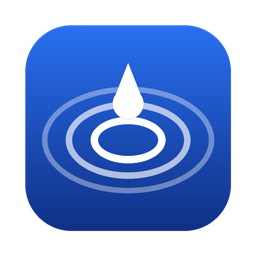
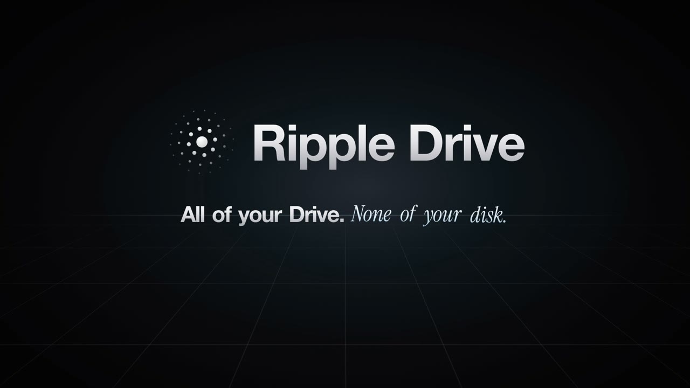

<p align="center">
  
</p>

<h1 align="center">Ripple Drive</h1>

<p align="center">
  <b>Your whole Google Drive as a disk on your Mac, or a drive on your Windows PC (beta).</b><br>
  Files stream as you open them, so a 50 GB video doesn't need 50 GB free.
</p>

<p align="center">
  <a href="https://kundankishore8929-gif.github.io/ripple-drive/setup.html"><b>Setup guide</b></a> ·
  <a href="docs/media/launch-film.mp4">Watch the 50-second film</a> ·
  <a href="docs/troubleshooting.md">Troubleshooting</a>
</p>

<p align="center">
  <a href="docs/media/launch-film.mp4"></a>
</p>

## What you get

- **Your Drive next to your other disks**, with My Drive and Shared with me: in Finder's sidebar on a Mac, as **Ripple Drive (R:)** in File Explorer on Windows. It works in any app: Premiere, Resolve, QuickTime, VLC, Photoshop.
- **Almost no disk space used.** Only the parts you open are downloaded, and the cache stays under 2 GB.
- **Uploads that resume.** If your Wi-Fi drops or your computer sleeps, the upload carries on from the last byte. It is checked against Drive when done.
- **A small app by the clock** (the Mac menu bar, or the Windows taskbar) with upload progress, drag-and-drop uploads, search across your Drive (**⌃⌥F** on a Mac, **Ctrl+Alt+F** on Windows) and one-click share links.
- **Private.** It uses your own Google key and talks only to Google. There is no server, no account and no tracking.

**You need:** a Google account, and either
- a **Mac** with an Apple chip (M1 or later) on macOS 26 or later, or
- a **Windows 10 or 11** PC (64-bit). The Windows version is in **beta**: it passes [automatic tests on GitHub's Windows machines](.github/workflows/windows.yml) but hasn't been used on many real PCs yet. Please [report anything odd](https://github.com/kundankishore8929-gif/ripple-drive/issues).

Setup takes about 30 minutes, once.

## Setup checklist

Prefer clicking through it? The [setup guide](https://kundankishore8929-gif.github.io/ripple-drive/setup.html) has the same steps with copy buttons, and a Mac / Windows switch.

**Part 1: your free Google key (about 10 min). Same on Mac and Windows.**

- [ ] **Turn on 2-Step Verification** at [myaccount.google.com/security](https://myaccount.google.com/security). Google Cloud needs it.
- [ ] **Create a project** at [console.cloud.google.com](https://console.cloud.google.com): project picker › New project › name it `Ripple Drive` › Create, then select it.
- [ ] **Turn on the Drive API**: open [Google Drive API](https://console.cloud.google.com/apis/library/drive.googleapis.com) › Enable.
- [ ] **Set up the sign-in screen** in [Google Auth Platform](https://console.cloud.google.com/auth/overview) › Get started:
  - App name `Ripple Drive`, your email, Audience **External** › Create.
  - Audience › Test users › add your own Gmail.
  - Data access › Add or remove scopes › paste `https://www.googleapis.com/auth/drive` › Add to table › Update › Save.
- [ ] **Create your client ID**: Clients › Create client › **Desktop app** › Create.
  - Save the Client ID and secret in a note, and click Download JSON. Google may not show the secret again.
  - Never paste the secret anywhere except the installer (Terminal on a Mac, PowerShell on Windows).
- [ ] **Download** this repo: green **Code** button › **Download ZIP**. Mac: open the ZIP. Windows: right-click it › **Extract All**.

**Part 2 on a Mac (about 15 min)**

- [ ] **Install Homebrew** if `brew --version` in Terminal says "command not found". Get it from [brew.sh](https://brew.sh).
- [ ] **Run the installer** in Terminal:
  ```bash
  cd ~/Downloads/ripple-drive-main
  zsh install.sh
  ```
  It asks for your Mac password, then your Client ID and secret.
- [ ] **Sign in with Google** in the browser that opens.
  - On "Google hasn't verified this app", click **Advanced › Go to Ripple Drive**. It's your own app.
  - Tick the Drive box, then click Continue.
- [ ] **Turn on fuse-t**: System Settings › General › Login Items & Extensions › Extensions › By Category › File System Extensions › **fuse-t** on.
- [ ] Click the Ripple icon in the menu bar › **Reconnect Drive**. Ripple Drive now shows in Finder.

**Part 2 on Windows, beta (about 15 min)**

- [ ] **Open PowerShell in the folder**: open the extracted `ripple-drive-main` folder until you see `install.sh` and `windows`, click the address bar, type `powershell`, press Enter.
- [ ] **Run the installer**:
  ```powershell
  powershell -ExecutionPolicy Bypass -File windows\install.ps1
  ```
  - Click **Yes** when Windows asks to allow **WinFsp** (it lets Windows show the drive).
  - It adds Python if your PC doesn't have it, then asks for your Client ID and secret.
- [ ] **Sign in with Google** in the browser that opens, the same way as on a Mac (Advanced › Go to Ripple Drive, tick the Drive box, Continue).
- [ ] **Find your drive**: File Explorer › This PC › **Ripple Drive (R:)**. The Ripple icon is by the clock (click **^** if it's hidden, and drag it onto the taskbar).

## Daily use

| To | Mac | Windows (beta) |
|---|---|---|
| Open a file | Open it from Ripple Drive in Finder | Open it from **Ripple Drive (R:)** in File Explorer |
| Upload big files | Right-click › Services › **Upload to Ripple Drive**, or drag onto the menu-bar icon | Right-click › **Ripple Drive › Upload to Ripple Drive** (Windows 11: Show more options first), or the icon › **Upload Window** |
| Upload and free space | Right-click › Services › **Move to Ripple Drive**. The original goes to the Trash after Drive confirms the copy. | Right-click › **Ripple Drive › Move to Ripple Drive**. The original goes to the Recycle Bin after Drive confirms the copy. |
| Find a file | **⌃⌥F**, type a name. ⌘⇧C copies its share link. | **Ctrl+Alt+F**, type a name. Ctrl+Shift+C copies its share link. |
| Fix a stuck drive | Menu-bar icon › **Reconnect Drive** | Taskbar icon › **Reconnect Drive** |

## Common problems

- **Icon turned red:** your sign-in expired. Click the icon › **Sign In Again**. Google ends it every 7 days while your Google app is in Testing; [publish the app](docs/google-setup.md) to stop this.
- **"Access blocked … has not completed verification":** add your Gmail as a test user (Part 1, step 4).
- **Mac: not in Finder:** check that fuse-t is on, then click **Reconnect Drive**.
- **Windows: no R: drive:** click the taskbar icon › **Reconnect Drive**. If R: is taken, run the installer again with `-Drive S:`.

More fixes: [troubleshooting](docs/troubleshooting.md). How it works: [how-it-works](docs/how-it-works.md).

## Update or uninstall

| | Mac (in Terminal) | Windows (in PowerShell) |
|---|---|---|
| Update | Download the ZIP again, run `zsh install.sh` | Download the ZIP again, run `powershell -ExecutionPolicy Bypass -File windows\install.ps1` |
| Uninstall | `zsh uninstall.sh` (add `--all` to also remove the Google sign-in) | `powershell -ExecutionPolicy Bypass -File windows\uninstall.ps1` (add `-All` to also remove the Google sign-in) |

Your files in Google Drive are never touched.

---

Built on [rclone](https://rclone.org) (MIT), [fuse-t](https://www.fuse-t.org) on Mac (free for non-commercial use) and [WinFsp](https://winfsp.dev) on Windows (GPLv3, free). MIT © 2026 Kundan Kishore. Not affiliated with Google.
